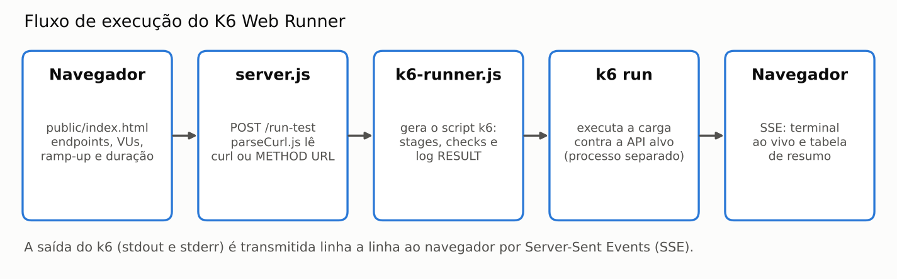
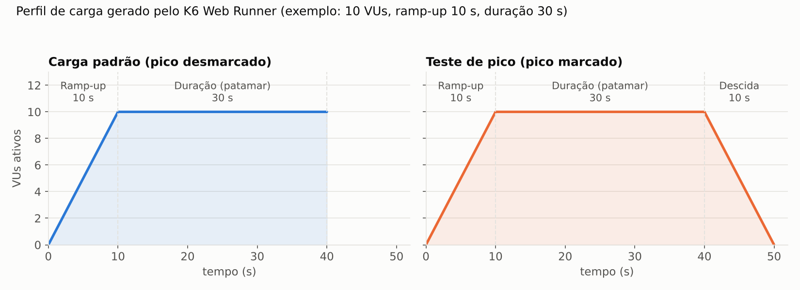
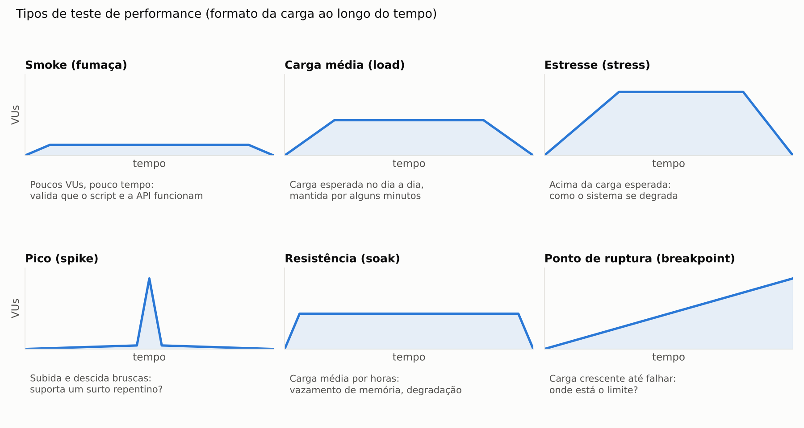

# K6 Web Runner

Interface web para executar **testes de carga em APIs HTTP com k6**, com saída do terminal transmitida ao vivo para o navegador (Server-Sent Events). Você configura usuários virtuais, ramp-up, duração e validações, roda o teste e acompanha a execução sem usar linha de comando.


*Execução real: 10 VUs, ramp-up de 10 s e duração de 30 s (40 s no total) contra a DummyJSON — 17.547 requisições, cerca de 438 requisições por segundo e 0 erros.*

## Sumário

1. [Como começar](#-como-começar)
2. [Solução de problemas (Windows)](#-solução-de-problemas-windows)
3. [Como usar a interface](#-como-usar-a-interface)
4. [Como o projeto funciona por dentro](#-como-o-projeto-funciona-por-dentro)
5. [Que tipo de teste é executado](#-que-tipo-de-teste-é-executado)
6. [Quem define os tempos e parâmetros de performance e como eles são definidos](#-quem-define-os-tempos-e-parâmetros-de-performance-e-como-eles-são-definidos)
7. [Onde os tempos e parâmetros estão definidos no projeto](#-onde-os-tempos-e-parâmetros-estão-definidos-no-projeto)
8. [O que o k6 mede e como ler o resultado](#-o-que-o-k6-mede-e-como-ler-o-resultado)
9. [Checks x thresholds: o que aprova ou reprova o teste](#-checks-x-thresholds-o-que-aprova-ou-reprova-o-teste)
10. [Limitações conhecidas](#-limitações-conhecidas)
11. [Estrutura do projeto](#-estrutura-do-projeto)
12. [Detalhe técnico: o parser da tabela de resumo](#-detalhe-técnico-o-parser-da-tabela-de-resumo)
13. [CI](#-ci)
14. [Perguntas frequentes em entrevista técnica](#-perguntas-frequentes-em-entrevista-técnica)
15. [Referências](#-referências)

---

## 🚀 Como começar

### 1. Instale o k6 (única dependência de sistema)

**Windows:**
```powershell
winget install k6 --source winget
```

> ⚠️ **Atenção (Windows):** em alguns casos o `winget` informa "já instalado", mas o `k6.exe` não fica acessível no PATH do terminal. Se `k6 version` der erro de "não reconhecido" mesmo após reiniciar o terminal, use o caminho alternativo abaixo.

**macOS:**
```bash
brew install k6
```

**Linux (Debian/Ubuntu):**
```bash
sudo apt install k6
```

**Alternativa universal (mais confiável no Windows):** baixe o instalador oficial:
- Link fixo, sempre a versão mais recente: **https://dl.k6.io/msi/k6-latest-amd64.msi**
- Ou escolha uma versão específica em: https://github.com/grafana/k6/releases
- Execute o `.msi` (Next → Next → Install → Finish)
- **Feche e abra um terminal novo** (o PATH só recarrega em uma sessão nova)
- Confirme com: `k6 version`

### 2. Clone o repositório

```bash
git clone https://github.com/moiseschiaretto/k6-web-runner.git
cd k6-web-runner
```

### 3. Instale as dependências Node.js

```bash
npm install
```

### 4. Inicie o servidor

```bash
npm start
```


Acesse **http://localhost:3000** no navegador. Não confunda com a URL da API que será testada: `localhost:3000` é a interface do próprio projeto, rodando na sua máquina.

**Teste rápido:** cole a linha abaixo no campo **Endpoints** e clique em **▶ Rodar teste de carga**:

```
GET https://dummyjson.com/products/1
```


Se a tabela **Resumo por endpoint** aparecer preenchida com requisições, tempo médio e 0 erros, está tudo funcionando.

---

## 🔧 Solução de problemas (Windows)

Problemas reais encontrados na instalação em Windows, documentados para quem passar pelo mesmo.

### "k6 não é reconhecido como um comando"

O instalador colocou o `k6.exe` no disco, mas o `PATH` do terminal ainda não sabe onde procurá-lo.

**1. Confirme que o k6 está instalado:**
```powershell
Test-Path "C:\Program Files\k6\k6.exe"
```
Se retornar `True`, o k6 está instalado e o problema é só o PATH.

**2. Solução rápida (vale só para a sessão atual do terminal):**
```powershell
$env:Path += ";C:\Program Files\k6"
k6 version
```

**3. Solução permanente:**
```powershell
[Environment]::SetEnvironmentVariable("Path", $env:Path + ";C:\Program Files\k6", "Machine")
```
Pode pedir permissão de administrador. Depois, feche e abra um terminal novo.

### `winget install k6` diz "já instalado", mas nada funciona

É um registro inconsistente do `winget`: ele acredita que instalou, mas o binário não está acessível. Nesse caso, instale pelo `.msi` (link fixo na seção anterior).

### `npm start` falha com "k6 não encontrado"

Sintoma:
```
Error: k6 não encontrado. Instale com: https://grafana.com/docs/k6/latest/set-up/install-k6/
```
O processo Node.js não está enxergando o `k6` no PATH da sessão em que o `npm start` foi executado. Resolva o PATH **na mesma janela de terminal** em que o `npm start` será executado: um ajuste temporário feito em outra janela não vale ali.

---

## 🖥️ Como usar a interface

1. Cole um ou mais endpoints no campo de texto. São aceitos o comando `curl` completo **ou** o formato simples `METHOD URL`, um por linha.
2. Configure os parâmetros do teste (tabela abaixo).
3. Clique em **▶ Rodar teste de carga**.
4. Acompanhe a saída do k6 no terminal embutido e a tabela **Resumo por endpoint**, que se preenche conforme os resultados chegam.

### O que cada campo faz

| Campo | Padrão | O que faz |
|---|---|---|
| **Endpoints** | — | Um endpoint por linha: `curl` completo ou `METHOD URL`. Único campo obrigatório |
| **VUs (usuários virtuais)** | `10` | Quantidade de usuários virtuais executando as requisições **ao mesmo tempo** |
| **Ramp-up** | `10s` | Tempo para subir de 0 até o número de VUs configurado, de forma gradual |
| **Duração** | `30s` | Tempo em que a carga fica **mantida** no número máximo de VUs, depois do ramp-up |
| **Validar status** | `SEM STATUS` | Cria um *check* que exige o status HTTP escolhido (200, 201, 204, 400, 401 ou 404) |
| **Limite de tempo de resposta (ms)** | `1000` | Cria um *check* que exige resposta abaixo desse tempo |
| **Token Bearer** | vazio | Incluído no header `Authorization: Bearer ...` de todas as requisições, quando a requisição ainda não tem esse header |
| **Teste de pico** | desmarcado | Acrescenta uma fase final de **descida de 10 s** até 0 VUs (detalhes em [Perfil de carga](#perfil-de-carga-gerado)) |

**Tempo total do teste** = Ramp-up + Duração (+ 10 s, se o teste de pico estiver marcado).
No exemplo padrão: 10 s + 30 s = **40 s**, que é o tempo mostrado no terminal (`running (0m40.0s)`).

Os campos de tempo usam o formato do k6: `10s`, `1m`, `1m30s`, `2h`.

O exemplo pré-preenchido usa a [DummyJSON](https://dummyjson.com), uma API pública estável. Troque pelos endpoints que quiser testar.

### Por que isso é diferente de só rodar `k6 run` no terminal

- **Sem escrever script:** o script do k6 é gerado automaticamente a partir dos endpoints e dos parâmetros.
- **Streaming ao vivo via SSE:** a saída do processo k6 chega ao navegador linha a linha, durante a execução.
- **Suporte a `curl`:** basta colar o comando copiado do DevTools ou do Postman, sem conversão manual.

---

## ⚙️ Como o projeto funciona por dentro



1. O navegador envia endpoints e parâmetros para `POST /run-test` (`server.js`).
2. `src/utils/parseCurl.js` converte cada linha (`curl` ou `METHOD URL`) em `{ url, method, headers, body }`. Um `curl` com `-d` e sem `-X` é tratado como `POST`, igual ao comportamento do próprio `curl`.
3. `src/k6-runner.js` gera o script do k6 com:
   - `options.stages`: o perfil de carga (ramp-up, patamar e, no teste de pico, descida);
   - um `group` por endpoint, com a requisição HTTP;
   - os `check` de status e de tempo de resposta;
   - um `console.log('RESULT:...')` com endpoint, método, status e duração de cada requisição.
4. O script é gravado em um arquivo temporário e executado com `k6 run`, em um processo separado.
5. A saída do k6 (stdout e stderr) é transmitida ao navegador por SSE. Ao final, o arquivo temporário é apagado.
6. O navegador mostra a saída no terminal embutido e monta a tabela de resumo a partir das linhas `RESULT:`.

### Perfil de carga gerado



Os `stages` do k6 gerados pelo projeto:

```javascript
// Teste de pico desmarcado
stages: [
  { duration: rampUp,   target: vus },  // sobe de 0 até o número de VUs
  { duration: duration, target: vus },  // mantém o patamar
]

// Teste de pico marcado
stages: [
  { duration: rampUp,   target: vus },
  { duration: duration, target: vus },
  { duration: '10s',    target: 0 },    // descida até 0 VUs
]
```

Cada VU repete o mesmo ciclo enquanto o teste dura: executa **todos os endpoints em sequência** e recomeça imediatamente, sem pausa entre as iterações.

---

## 🧪 Que tipo de teste é executado

O projeto executa **testes de performance no nível de protocolo HTTP**: o k6 envia requisições diretamente à API, sem abrir navegador e sem renderizar páginas. O que se mede é o comportamento do **servidor** sob carga: tempo de resposta, vazão (requisições por segundo) e taxa de erros.

O **tipo** de teste não é fixo: ele depende de como os parâmetros são configurados. A documentação do k6 (Grafana) classifica os testes pelo formato da carga ao longo do tempo:



| Tipo | Objetivo | Como configurar nesta interface (exemplo) |
|---|---|---|
| **Smoke (fumaça)** | Confirmar que o script e a API funcionam com carga mínima | 1 a 2 VUs, ramp-up `2s`, duração `30s` |
| **Carga média (load)** | Medir o comportamento com o tráfego esperado no dia a dia | VUs equivalentes ao tráfego normal, ramp-up `1m`, duração `5m` a `15m` |
| **Estresse (stress)** | Observar como o sistema se degrada acima da carga esperada | VUs acima do tráfego normal (ex.: 2× a carga média), duração de alguns minutos |
| **Pico (spike)** | Verificar se o sistema suporta um surto repentino | Muitos VUs, ramp-up **curto** (`2s` a `5s`), duração curta, **Teste de pico** marcado |
| **Resistência (soak)** | Encontrar degradação ao longo do tempo (ex.: vazamento de memória) | Carga média, duração longa (`1h` ou mais) |
| **Ponto de ruptura (breakpoint)** | Descobrir a capacidade máxima | Não há rampa contínua na interface: executar rodadas sucessivas aumentando os VUs até surgirem erros ou lentidão |

> Os valores da coluna da direita são **exemplos**. Os valores reais saem dos requisitos e do tráfego de cada sistema, como explicado na próxima seção.

O workflow de CI deste repositório executa, na prática, um **smoke test**: 2 VUs, ramp-up de 2 s e duração de 3 s.

---

## 🏛️ Quem define os tempos e parâmetros de performance e como eles são definidos

### Não existe um limite oficial universal para APIs

Diferente das páginas web, em que o Google publica os limites dos Core Web Vitals, **não existe um órgão que defina o tempo de resposta "correto" de uma API**. O k6 também não impõe nenhum limite: ele só mede. Os critérios de aprovação são **definidos por cada projeto**.

### Quem define

| Quem | O que define |
|---|---|
| **Negócio e produto** (PO, clientes, contratos) | O **SLA** (Service Level Agreement): compromisso formal com o cliente, por exemplo, "99,9% de disponibilidade" ou "95% das requisições em menos de 500 ms" |
| **Engenharia e arquitetura** (SRE, arquitetos, desenvolvedores) | O **SLO** (Service Level Objective): meta interna, normalmente mais rígida que o SLA, para haver margem de segurança |
| **QA / engenharia de performance** | Transforma requisitos não funcionais, SLA e SLO em **cenários de teste** (VUs, duração, perfil de carga) e em **critérios de aprovação** |

Em resumo: o **negócio** define o que é aceitável para o usuário e para o contrato, a **engenharia** define as metas técnicas, e o **QA** traduz tudo isso em parâmetros de teste e verifica se as metas são cumpridas.

### Como os valores são definidos

**1. Tempo de resposta aceitável.** Parte da percepção humana. A referência clássica é Jakob Nielsen (1993):

| Tempo | Percepção do usuário |
|---|---|
| **até 0,1 s** | O sistema parece reagir instantaneamente |
| **até 1 s** | O usuário percebe a espera, mas não perde o raciocínio |
| **até 10 s** | Limite para manter a atenção. Acima disso, o usuário passa a fazer outra coisa |

Uma tela costuma depender de **várias** chamadas de API. Por isso as metas de cada API geralmente ficam bem abaixo de 1 s.

**2. Linha de base (baseline).** Mede-se o comportamento atual do sistema, com ferramentas de monitoramento (APM) ou com um primeiro teste de carga média. As metas não podem ignorar o que o sistema já entrega.

**3. Quantidade de VUs.** Vem do tráfego esperado, levantado em ferramentas de analytics, logs ou na projeção do negócio (lançamentos, campanhas, datas sazonais). A relação entre usuários simultâneos e tráfego segue a **Lei de Little**:

```
usuários simultâneos = taxa de chegada × tempo médio de permanência
```

Exemplo: 50 usuários por segundo, cada um permanecendo 6 s no fluxo, resultam em cerca de 300 usuários simultâneos.

**4. Ramp-up.** Sobe a carga aos poucos para não confundir o "susto" inicial (conexões abrindo, cache vazio, escalonamento automático) com o comportamento real do sistema. O projeto usa **10 s** como padrão.

**5. Duração.** Precisa ser longa o bastante para o sistema se estabilizar e para haver amostras suficientes. Testes de carga reais costumam durar de minutos a horas. Os **30 s** padrão do projeto servem para demonstração e para validação rápida.

**6. Percentil, não média.** As metas devem ser definidas em **percentil** (p95 ou p99), não em média. A média esconde os casos lentos: com p95 < 500 ms, 95% das requisições precisam responder em menos de 500 ms, e no máximo 5% podem passar disso.

### Como os padrões deste projeto foram definidos

| Parâmetro | Padrão | Origem |
|---|---|---|
| VUs | `10` | Valor de demonstração do projeto: gera carga perceptível sem sobrecarregar uma API pública |
| Ramp-up | `10s` | Escolha do projeto, para evitar o início com todos os VUs de uma vez |
| Duração | `30s` | Escolha do projeto, adequada para demonstração e validação rápida |
| Limite de tempo de resposta | `1000 ms` | Ponto de partida do projeto. Coincide com o limite de 1 s de Nielsen, em que o usuário percebe a espera mas mantém o raciocínio |
| Descida no teste de pico | `10s` | Valor fixo do projeto |

Em um projeto real, esses valores são **substituídos** pelos números do SLA, do SLO e do tráfego do sistema testado.

---

## 🗂️ Onde os tempos e parâmetros estão definidos no projeto

| Arquivo | O que define | Valores |
|---|---|---|
| `public/index.html` | Valores iniciais exibidos no formulário | VUs `10`, ramp-up `10s`, duração `30s`, status `SEM STATUS`, limite `1000` ms |
| `public/script.js` | Valores usados quando um campo fica vazio | VUs `1`, ramp-up `10s`, duração `30s`, limite `1000` ms |
| `src/k6-runner.js` | Padrões do gerador de script, montagem dos `stages` e dos `check` | VUs `1`, ramp-up `10s`, duração `30s`, `SEM STATUS`, limite `1000` ms, descida do pico `10s` |
| `server.js` | Limites do servidor da própria interface (não do teste de carga) | Porta `3000` (ou variável `PORT`), máximo de **10 execuções por minuto** (`express-rate-limit`), corpo da requisição de até `1mb` |
| `.github/workflows/smoke-test.yml` | Parâmetros do smoke test de CI | 2 VUs, ramp-up `2s`, duração `3s`, tempo máximo de `20` s para a chamada |

Trecho de `src/k6-runner.js` que gera os *checks*:

```javascript
if (statusValidation !== 'SEM STATUS') {
  check(res, { 'status é 200': (r) => r.status === 200 });          // exemplo com 200
}
check(res, { 'tempo de resposta < 1000ms': (r) => r.timings.duration < 1000 });
```

---

## 📊 O que o k6 mede e como ler o resultado

### Composição do tempo de uma requisição

O k6 divide cada requisição HTTP em fases:

| Métrica do k6 | Significado |
|---|---|
| `http_req_blocked` | Espera por uma conexão TCP livre antes de iniciar a requisição |
| `http_req_connecting` | Tempo para estabelecer a conexão TCP |
| `http_req_tls_handshaking` | Tempo da negociação TLS (HTTPS) |
| `http_req_sending` | Tempo para enviar a requisição |
| `http_req_waiting` | Espera pela resposta do servidor: o **TTFB** (time to first byte) |
| `http_req_receiving` | Tempo para receber a resposta |
| **`http_req_duration`** | **Tempo total da requisição = sending + waiting + receiving.** Não inclui DNS nem abertura de conexão |

O tempo usado nos *checks* e na tabela de resumo é o `res.timings.duration`, que corresponde ao `http_req_duration`.

### Outras métricas do resumo final

| Métrica | Significado |
|---|---|
| `http_reqs` | Total de requisições e vazão (requisições por segundo) |
| `http_req_failed` | Taxa de requisições com falha (por padrão, status fora da faixa 200–399) |
| `iterations` / `iteration_duration` | Quantidade e duração de cada ciclo completo de um VU |
| `vus` / `vus_max` | VUs ativos e máximo de VUs |
| `checks` | Percentual de *checks* aprovados |
| `data_received` / `data_sent` | Volume de dados trafegado |

### Estatísticas exibidas

O k6 mostra, para cada métrica de tempo: `avg` (média), `min`, `med` (mediana), `max`, `p(90)` e `p(95)`.

Exemplo real, da captura do início deste README (`iteration_duration`): `avg=19.94ms`, `med=19.07ms`, `p(90)=23.52ms`, `p(95)=28.67ms` e `max=83.53ms`. Leitura: 95% das iterações levaram menos de 28,67 ms, e a pior levou 83,53 ms.

Vazão do mesmo exemplo: 17.547 requisições ÷ 40 s ≈ **438 requisições por segundo**.

### Tabela "Resumo por endpoint"

A tabela é montada **no navegador**, a partir das linhas `RESULT:` geradas pelo script:

| Coluna | Cálculo |
|---|---|
| Requisições | Quantidade de linhas `RESULT:` do endpoint |
| Média (ms) | Soma das durações ÷ quantidade |
| Min / Max | Menor e maior duração |
| Erros | Respostas com status ≥ 400 ou status 0 (sem resposta, por exemplo timeout ou falha de conexão) |

Os **percentis** (p90 e p95) aparecem no resumo do k6, no terminal embutido.

---

## ✅ Checks x thresholds: o que aprova ou reprova o teste

Esta é uma distinção importante do k6:

| | **Check** | **Threshold** |
|---|---|---|
| O que é | Verificação de **cada resposta** (ex.: status 200, tempo < 1000 ms) | Critério de aprovação sobre o **conjunto** das métricas (ex.: p95 < 500 ms) |
| Se falhar | Registra a falha no percentual `checks` do resumo; **o teste continua e termina com código 0** | **Reprova o teste**: o k6 termina com código de saída diferente de zero |
| Uso típico | Validar respostas | Critério de aprovação (*quality gate*) em pipeline de CI |

**Este projeto usa apenas checks.** Portanto, o resultado precisa ser lido no resumo do k6: a linha `checks` mostra o percentual aprovado, e a tabela de resumo mostra os erros por endpoint. O código `0` em `[K6] Execução finalizada com código 0` indica que o k6 executou até o fim, **não** que todas as metas foram atingidas.

Para transformar o teste em critério de aprovação, a evolução natural é incluir *thresholds* no `options` do script gerado. Exemplo da documentação do k6:

```javascript
export const options = {
  thresholds: {
    http_req_failed: ['rate<0.01'],     // menos de 1% de falhas
    http_req_duration: ['p(95)<200'],   // 95% das requisições abaixo de 200 ms
  },
};
```

---

## ⚠️ Limitações conhecidas

- **Sem tempo de pausa (*think time*).** O script não usa `sleep()`. Cada VU dispara a próxima requisição assim que recebe a anterior. Por isso **10 VUs não equivalem a 10 usuários reais**: no exemplo, 10 VUs geraram cerca de 438 requisições por segundo. Usuários reais fazem pausas entre ações.
- **Gerador de carga na mesma máquina.** O k6 roda no computador de quem executa o teste. A CPU, a memória e a rede dessa máquina também limitam a carga gerada e entram no tempo medido.
- **Teste de pico com subida configurável.** O modo de pico usa o mesmo ramp-up informado no formulário e acrescenta a descida de 10 s. Para um pico de verdade, combine-o com um ramp-up **curto** e um número alto de VUs.
- **Um `console.log` por requisição.** A linha `RESULT:` alimenta a tabela de resumo, mas com volumes muito altos de requisições gera consumo extra de CPU no gerador de carga.
- **Validação de tempo sempre ativa pela interface.** O gerador aceita desligar o *check* de tempo (`disableResponseValidation`), mas a interface não oferece essa opção.
- **Uso responsável.** Só execute testes de carga contra sistemas próprios ou com autorização. APIs públicas de exemplo, como a DummyJSON, devem receber cargas pequenas.

---

## 📁 Estrutura do projeto

```
server.js                  # Express + SSE: recebe a configuração, gera o script k6, executa e transmite a saída
src/
  k6-runner.js             # gera o script k6 (stages, checks e log RESULT) a partir dos endpoints
  utils/parseCurl.js       # converte comando curl (ou "METHOD URL") em {url, method, headers, body}
public/
  index.html, style.css, script.js   # interface: formulário, terminal ao vivo e tabela de resumo
.github/
  workflows/smoke-test.yml # CI: sobe o servidor e executa um smoke test contra a DummyJSON
docs/
  screenshots/
    screenshot-execucao-com-sucesso.png   # execução com 17.547 requisições
    servidor-iniciado-terminal.png        # npm start rodando com sucesso
    interface-exemplo-dummyjson.png       # interface completa com exemplo rodando
    fluxo-execucao.png                    # fluxo navegador → servidor → k6 → navegador
    perfil-de-carga.png                   # perfil de carga padrão e de pico
    tipos-de-teste-performance.png        # tipos de teste de performance
```

---

## 🔍 Detalhe técnico: o parser da tabela de resumo

O k6 registra cada `console.log()` no próprio log estruturado, neste formato:

```
time="2026-07-03T10:59:25-03:00" level=info msg="RESULT:{\"endpoint\":\"...\",\"status\":200,\"duration\":18.97}" source=console
```

Para extrair esse dado no navegador, duas situações são tratadas:

1. **As aspas internas chegam escapadas** (`\"`), porque estão dentro do campo `msg="..."` do log. O escape é desfeito antes de interpretar o JSON.
2. **A leitura do stream (SSE) pode cortar uma linha ao meio** entre dois pacotes de rede. O parser guarda o texto incompleto em um buffer e só processa a linha quando ela termina com quebra de linha.

---

## 🔄 CI

O workflow `.github/workflows/smoke-test.yml` roda a cada **push** e a cada **pull request** na branch `main`:

1. Instala Node.js 20, as dependências e o k6.
2. Sobe o servidor em segundo plano.
3. Dispara um **smoke test** contra `GET https://dummyjson.com/products/1`, com 2 VUs, ramp-up de 2 s e duração de 3 s.
4. Confirma que o k6 executou de fato, procurando linhas `RESULT:` na saída.
5. Em caso de falha, exibe o log do servidor.

O objetivo do CI é garantir que **a ferramenta continua funcionando** a cada alteração, e não medir a performance da DummyJSON.

---

## 🎤 Perguntas frequentes em entrevista técnica

**Quem define o tempo de resposta aceitável de uma API?**
Não existe um padrão universal. O negócio define o SLA (compromisso com o cliente), a engenharia define o SLO (meta interna, mais rígida) e o QA transforma esses números em cenários e critérios de teste. Como referência de percepção humana, usa-se Nielsen: 0,1 s parece instantâneo, 1 s mantém o raciocínio e 10 s é o limite da atenção.

**De onde vem o número de VUs?**
Do tráfego esperado (analytics, logs, projeção do negócio), convertido em usuários simultâneos pela Lei de Little: usuários simultâneos = taxa de chegada × tempo médio de permanência.

**Para que serve o ramp-up?**
Para subir a carga aos poucos e não confundir o efeito inicial (conexões abrindo, cache vazio, escalonamento automático) com o comportamento real do sistema.

**Por que usar p95 e não a média?**
Porque a média esconde os casos lentos. O p95 garante que 95% das requisições ficaram abaixo do limite.

**Qual a diferença entre check e threshold no k6?**
O check valida cada resposta e não muda o resultado do teste. O threshold é o critério de aprovação: se falhar, o k6 termina com código diferente de zero e o pipeline reprova.

**O que o `http_req_duration` mede?**
Envio + espera (TTFB) + recebimento. Não inclui DNS nem abertura de conexão.

**Que tipos de teste de performance existem?**
Smoke, carga média, estresse, pico, resistência (soak) e ponto de ruptura (breakpoint). O que muda entre eles é o formato da carga ao longo do tempo e o objetivo.

**10 VUs são 10 usuários reais?**
Não neste projeto. Sem pausas entre requisições, cada VU gera muito mais tráfego que um usuário real. Para simular usuários, adiciona-se *think time* com `sleep()`.

---

## 📚 Referências

- [Test types — documentação do k6 (Grafana)](https://grafana.com/docs/k6/latest/testing-guides/test-types/)
- [Thresholds — documentação do k6](https://grafana.com/docs/k6/latest/using-k6/thresholds/)
- [Checks — documentação do k6](https://grafana.com/docs/k6/latest/using-k6/checks/)
- [Built-in metrics — documentação do k6](https://grafana.com/docs/k6/latest/using-k6/metrics/reference/)
- [Response Times: The 3 Important Limits — Jakob Nielsen (Nielsen Norman Group)](https://www.nngroup.com/articles/response-times-3-important-limits/)
