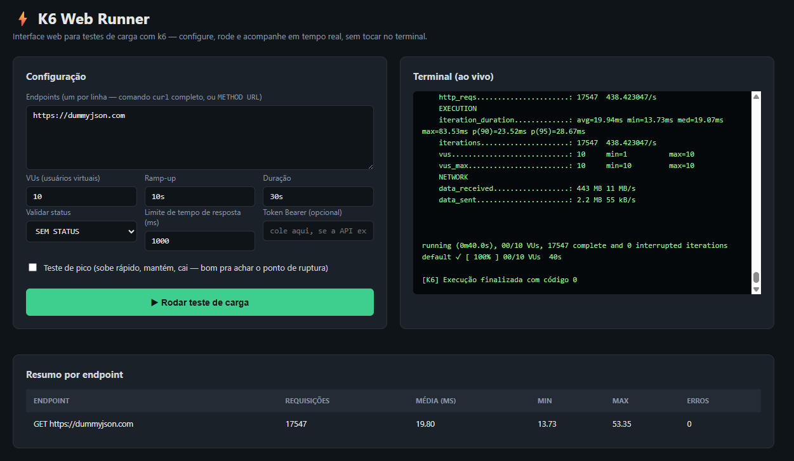
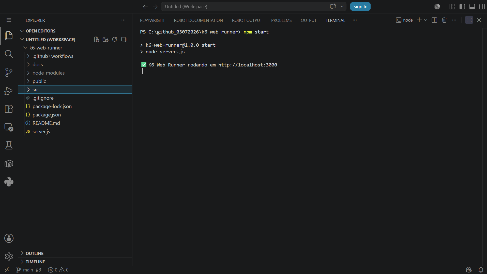
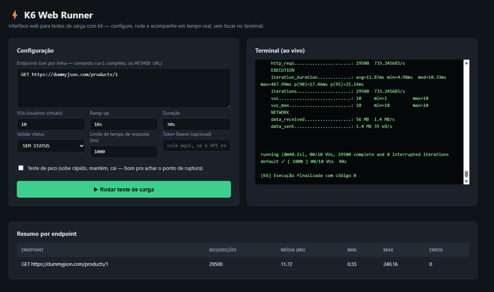

# K6 Web Runner

Interface web para executar testes de carga com **k6**, com streaming de terminal em tempo real (SSE) — configure VUs, ramp-up, duração e validação de status, e acompanhe a execução ao vivo no navegador, sem tocar em linha de comando.


*Execução real: 10 VUs por 40s contra a DummyJSON, 17.547 requisições, 0% de erro, tabela de resumo preenchida.*

## 🚀 Como Começar

### 1. Instale o k6 (única dependência de sistema)

**Windows:**
```powershell
winget install k6 --source winget
```

> ⚠️ **Atenção (Windows):** em alguns casos o `winget` reporta "já instalado" mas o `k6.exe` não fica acessível no PATH do terminal. Se `k6 version` der erro de "não reconhecido" mesmo após reiniciar o terminal, use o caminho alternativo abaixo.

**macOS:**
```bash
brew install k6
```

**Linux (Debian/Ubuntu):**
```bash
sudo apt install k6
```

**Alternativa universal (mais confiável no Windows):** baixe o instalador oficial direto:
- Link fixo, sempre a versão mais recente: **https://dl.k6.io/msi/k6-latest-amd64.msi**
- Ou escolha uma versão específica em: https://github.com/grafana/k6/releases
- Execute o `.msi` (Next → Next → Install → Finish)
- **Feche e abra um terminal novo** (o PATH só recarrega em uma sessão nova)
- Confirme com: `k6 version`

### 2. Clone o repositório

```bash
git clone https://github.com/moiseschiaretto/k6-web-runner.git
cd k6-web-runner
```

### 3. Instale as dependências Node

```bash
npm install
```

### 4. Inicie o servidor

```bash
npm start
```



Acesse **http://localhost:3000** no navegador (não confunda com a URL da API que você vai testar — `localhost:3000` é a interface do próprio projeto, rodando na sua máquina).

---

## 🔧 Solução de problemas (Windows)

Documentando aqui os problemas reais encontrados ao instalar em uma máquina Windows, para quem passar pelo mesmo:

### "k6 não é reconhecido como um comando"

O instalador colocou o `k6.exe` no disco, mas o `PATH` do terminal ainda não sabe onde procurá-lo.

**1. Confirme que o k6 está instalado:**
```powershell
Test-Path "C:\Program Files\k6\k6.exe"
```
Se retornar `True`, o k6 está lá — é só questão de PATH.

**2. Solução rápida (vale só para a sessão atual do terminal):**
```powershell
$env:Path += ";C:\Program Files\k6"
k6 version
```

**3. Solução permanente (não precisa repetir depois):**
```powershell
[Environment]::SetEnvironmentVariable("Path", $env:Path + ";C:\Program Files\k6", "Machine")
```
Pode pedir permissão de administrador. Depois, feche e abra um terminal novo — `k6 version` deve funcionar direto, sempre.

### `winget install k6` diz "já instalado" mas nada funciona

Isso é um registro inconsistente do `winget` — ele acredita que instalou, mas o binário não está acessível. Nesse caso, ignore o winget e instale via `.msi` direto (veja o link fixo na seção acima). É mais confiável.

### `npm start` falha com "k6 não encontrado"

Sintoma:
```
Error: k6 não encontrado. Instale com: https://grafana.com/docs/k6/latest/set-up/install-k6/
```
Isso confirma que o processo Node não está enxergando o `k6` no PATH da sessão em que o `npm start` foi executado. Resolva o PATH (seção acima) **na mesma janela de terminal** onde você vai rodar `npm start` — se você ajustou o PATH numa janela e abriu outra pra rodar o projeto, o ajuste temporário não vale lá.

### Teste rápido para confirmar que está tudo funcionando

Com o servidor rodando em `http://localhost:3000`, cole isso no campo **Endpoints** da interface e clique em **▶ Rodar teste de carga**:

```
GET https://dummyjson.com/products/1
```



Se aparecer a tabela **Resumo por endpoint** preenchida com requisições, tempo médio e 0 erros, está tudo funcionando corretamente.

---

## Como usar a interface

1. Cole um ou mais endpoints no campo de texto — aceita comando `curl` completo **ou** o formato simples `METHOD URL` (um por linha).
2. Configure os parâmetros do teste (veja a tabela de campos abaixo).
3. Clique em **▶ Rodar teste de carga**.
4. Acompanhe a execução do k6 em tempo real no terminal embutido, e veja a tabela **Resumo por endpoint** preencher automaticamente conforme os resultados chegam.

### O que cada campo faz

| Campo | O que faz | Quando mexer |
|---|---|---|
| **Endpoints** | Um endpoint por linha — aceita `curl` completo ou `METHOD URL` | Sempre — é o único campo obrigatório |
| **VUs (usuários virtuais)** | Quantos "usuários" simulados batem na API ao mesmo tempo | Aumente para simular mais carga (ex: 50 para um pico) |
| **Ramp-up** | Tempo para subir gradualmente até o número de VUs, evitando começar com todos de uma vez | O padrão (10s) já é razoável para a maioria dos casos |
| **Duração** | Quanto tempo o teste roda depois do ramp-up | Aumente para um teste de carga mais representativo |
| **Validar status** | Se preenchido, o k6 marca como falha qualquer resposta que não seja o status escolhido | Deixe "SEM STATUS" se só quer medir tempo, sem validar sucesso |
| **Limite de tempo de resposta (ms)** | Define o que conta como "resposta lenta" nos checks do k6 | O padrão (1000ms) é um bom ponto de partida |
| **Token Bearer** | Aplicado automaticamente no header `Authorization` de todas as requisições | Só preencha se a API testada exigir autenticação |
| **Teste de pico** | Muda o padrão de carga: sobe rápido, mantém, cai rápido — ajuda a achar o ponto de ruptura do sistema | Marque quando quiser testar o limite, não só um cenário normal |

O exemplo pré-preenchido usa a [DummyJSON](https://dummyjson.com), uma API pública estável — troque pelos endpoints que quiser testar.

## Por que isso é diferente de só rodar `k6 run` no terminal

- **Sem instalar nada além do k6 em si** — não precisa escrever scripts `.js` do k6 na mão para cada teste.
- **Streaming ao vivo via SSE** — a saída do processo k6 é transmitida linha a linha pro navegador conforme acontece, não só no final.
- **Suporte a colar `curl` direto** — cola o comando que você copiou do DevTools/Postman, sem converter manualmente.

## Estrutura

```
server.js                  # Express + SSE: recebe a config, gera o script k6, executa e transmite a saída
src/
  k6-runner.js               # gera dinamicamente o script k6 (stages, checks) a partir dos endpoints
  utils/parseCurl.js          # converte comando curl (ou "METHOD URL") em {url, method, headers, body}
public/
  index.html, style.css, script.js   # UI: formulário de configuração + terminal ao vivo + tabela de resumo
docs/
  screenshots/
    screenshot-execucao-com-sucesso.png   # execução em maior escala (17.547 requisições)
    servidor-iniciado-terminal.png         # npm start rodando com sucesso
    interface-exemplo-dummyjson.png        # interface completa com exemplo rodando
```

## Detalhe técnico: por que a tabela de resumo precisou de um parser específico

O k6 registra cada `console.log()` dentro do próprio log estruturado dele, no formato:

```
time="2026-07-03T10:59:25-03:00" level=info msg="RESULT:{\"endpoint\":\"...\",\"status\":200,\"duration\":18.97}" source=console
```

Duas coisas precisam ser tratadas para extrair esse dado no navegador:
1. **As aspas internas vêm escapadas** (`\"`) porque estão dentro do campo `msg="..."` do log — é preciso desfazer esse escape antes de interpretar como JSON.
2. **A leitura do stream (SSE) pode cortar uma linha ao meio** entre dois pacotes de rede — o parser guarda o texto incompleto em um buffer e só processa quando a linha estiver completa (terminada em quebra de linha).

## CI

O workflow (`.github/workflows/smoke-test.yml`) sobe o servidor, dispara um teste de carga curto contra a DummyJSON e confirma que o k6 realmente executou — validando que a ferramenta em si continua funcional a cada push.
